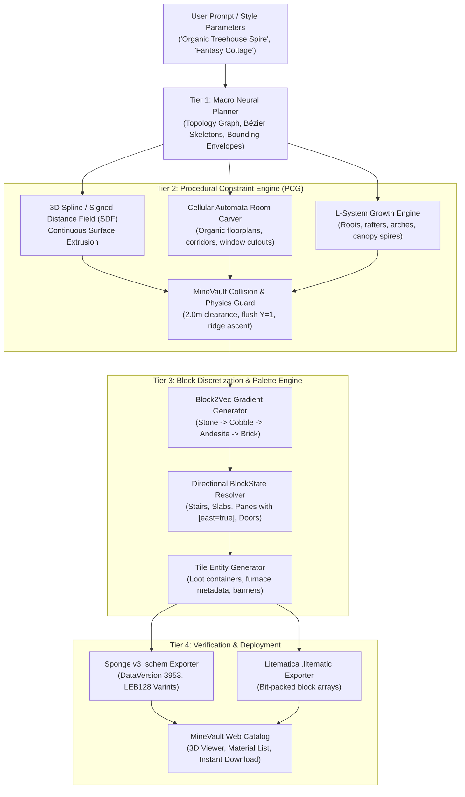

# AI-Driven Organic Minecraft Architecture: Engineering Roadmap & Implementation Plan

> **Target Platform:** Minecraft Java Edition 1.21.1+ (DataVersion 3953+)  
> **Output Formats:** Sponge Schematic v3 (`.schem`) & Fabric Litematica (`.litematic`)  
> **Core Architectural Paradigm:** Hybrid Neural Macro-Layout + Procedural Constraint Geometry (PCG)  
> **Repository Context:** [MineVault Catalog Platform](file:///c:/Users/ip762/OneDrive/Desktop/New%20folder)

---

## 1. Executive Summary & Strategy

This roadmap details the engineering specifications for an autonomous AI pipeline capable of generating professional-grade, structurally sound, and organically shaped Minecraft builds. 

Generating Minecraft architecture with machine learning presents distinct challenges:
1. **Discrete Combinatorial State Space:** Over 1,000 distinct block states with directional facing, waterlogging, half/shape properties, and strict physical attachment rules (e.g., lanterns, torches, doors).
2. **Navigability & Human Utility:** Builds cannot simply look good externally as a voxel point cloud; they must feature valid interior navigation, flush thresholds at $Y=1$, safe staircase ascents, and zero player collision clipping.
3. **Compute Realities:** Training a foundation 3D diffusion transformer (such as *Dream-Cubed*, 280M parameters on 15M chunks) costs upwards of \$600–\$1,000 per training run on multi-H100 clusters.

### The Solution: The Hybrid Neural-PCG Pipeline

Rather than attempting an end-to-end "pixels-to-blocks" foundation model that struggles with game rules and costs thousands of dollars, MineVault adopts a **two-tier hybrid system**:
- **Macro-Layer (Neural/Generative):** Proposes creative room topology, fluid skeletal curves, volume envelopes, and stylistic block themes from text prompts or reference inputs.
- **Micro-Layer (Procedural Constraint Grammars):** Enforces 100% collision clearance, structural support, wall infills, directional glass connections, roof bargeboards, and Sponge v3 NBT serialization.

---

## 2. Comparative Model Analysis: Feasibility for Indie Creators

| Model Paradigm | Architectural Examples | Strengths | Failure Modes & Limitations | Hardware & Budget Feasibility |
| :--- | :--- | :--- | :--- | :--- |
| **Foundation 3D Diffusion** | *Dream-Cubed* (280M params, 32³ discrete patches) | Generates novel terrain and complex structural volumes directly from massive data | High hallucination of invalid blockstates; floating doors/torches; no interior navigation guarantees | **Impractical for indie**: Requires 15M+ chunks and 192+ NVIDIA H100 hours (\$600–\$1,200 per run). |
| **Quantized NeRF / 3D Implicit** | *DreamCraft* (Continuous NeRF discretized to voxels) | Smooth, fluid organic curves; continuous 3D shapes from 2D image/text prompts | Discretization loss turns thin walls into disconnected fragments; ignores Minecraft collision clearance | **Moderate**: Requires local RTX 3080/4090 or cloud GPU instances (\$200–\$500 total). |
| **LLM Blueprint + PCG Compiler** | *T2BM* (Text-to-Blueprint), MineVault Hybrid Engine | 100% collision-safe, authentic block connections, perfectly formatted `.schem`, instant execution | Requires rule authoring for new architectural primitives (e.g. arches, domes, stairs) | **Extremely Feasible**: Runs in seconds on standard CPU / lightweight API (\$0 compute cost). |

---

## 3. Data Acquisition, Parsing & Standardization

### 3.1 Data Sources & Licensing Compliance
- **Curated Open Datasets:** Use existing open datasets such as the HuggingFace `Minecraft-Schematics` repository (~8,328 builds under MIT license) and public-domain CC0/CC-BY world packs.
- **Scraping Caveats:** Scraping platforms like PlanetMinecraft or CurseForge requires explicit builder permission for commercial redistribution. For MineVault's native library, all builds are generated in-house via verified scripts to guarantee 100% original copyright ownership.

### 3.2 Ingestion & Tokenization Pipeline
Using Node.js / Python tooling (`prismarine-nbt`, `prismarine-block`, or `anvil-parser`):
1. **NBT Decompression:** Unpack gzip streams from `.schem` and `.litematic` files.
2. **Palette Normalization:** Map heterogeneous block versions into standardized Minecraft 1.21.1 namespaced identifiers:
   $$\text{BlockState} = \texttt{minecraft:}\langle\text{name}\rangle[\langle\text{property}_1\rangle=\langle\text{val}_1\rangle, \dots]$$
3. **Patch Partitioning:** Downsample builds into $16 \times 16 \times 16$ or $32 \times 32 \times 32$ canonical volumes.
4. **Voxel Coordinate Tensor:** Store dense 3D varint tensors in $X$-fastest row-major order:
   $$\text{Index}(x, y, z) = x + z \cdot W + y \cdot W \cdot L$$

---

## 4. Algorithmic Organic Geometry (The Math of Fluid Builds)

Organic builds (trees, dragon spires, fantasy curves, caves, nautilus arches) rely on continuous mathematical representations before voxel discretization:

### 4.1 Parametric Splines & Bézier Curves
Rather than placing blocks along rigid grid axes, structural spines (e.g., roof ridges, flying buttresses, tree branches) are computed using 3D Cubic Bézier curves:
$$B(t) = (1-t)^3 P_0 + 3(1-t)^2 t P_1 + 3(1-t) t^2 P_2 + t^3 P_3, \quad t \in [0, 1]$$
- **Cross-Sectional Sweep:** A circular or elliptical radius $r(t)$ is swept along $B(t)$ and voxelized using 3D Bresenham or signed distance functions (SDF).

### 4.2 Cellular Automata for Organic Room Envelopes
To generate floorplans that feel naturally carved rather than rectangular:
1. Initialize a 2D/3D footprint grid with random seeds based on Simplex Noise.
2. Apply cellular automata iterations:
   $$S_{t+1}(x,y) = \begin{cases} 1 & \text{if } \sum \text{Neighbors}(S_t) \ge 5 \\ 0 & \text{otherwise} \end{cases}$$
3. Run topological flood-fill to ensure single-component connectivity (no inaccessible pocket rooms).
4. Carve doorways and corridors with guaranteed 2-block clearance.

### 4.3 Context-Free L-Systems for Branching Spires
Branching organic structures (tree trunks, wizard spires, cathedral rib-vaults) are generated via stochastic L-Systems:
- **Alphabet:** $V = \{F, +, -, \&, \wedge, /, \backslash, [, ]\}$
- **Production Rule Example:** $F \to F [+F] F [-F] [\&F]$
- **Turtle Interpretation:** Translates string commands into pitch, roll, and yaw vectors, stamping structural log rings into the voxel matrix.

---

## 5. Integration with MineVault Architectural Standards

Every build produced by the engine must strictly pass the validation rules defined in [.gemini/rules/minevault_standards.md](file:///c:/Users/ip762/OneDrive/Desktop/New%20folder/.gemini/rules/minevault_standards.md):

1. **Flush Walking Elevation:**  
   The external ground/porch, entrance door sill, and interior flooring must lie on the exact same plane ($Y=1$).
2. **2.0m Vertical Clearance:**  
   Every walkable block $(x, y, z)$ must have Air at $(x, y+1, z)$ and $(x, y+2, z)$.
3. **Ridge-Ascending Staircases:**  
   Stairs must always climb toward the central high roof ridge to provide $3.0$–$5.0$ blocks of overhead headroom, preventing the player from colliding with low sloping roof eaves.
4. **Directional Glass Panes:**  
   Glass panes cannot be placed bare (`minecraft:glass_pane`); they must carry directional connection flags matching their adjacent walls (e.g., `[north=true,south=true]`) to prevent isolated floating iron poles.
5. **Gable Triangle Closure:**  
   Wall infill must extend to the underside of the roof ridge with zero triangular air gaps.

---

## 6. Sponge v3 & Litematica Technical Serialization

To ensure seamless importing via **WorldEdit**, **Axiom**, and **Litematica** in Minecraft 1.21.1+:

### 6.1 Sponge Schematic v3 Specification
- **Root Tag:** Compound named `Schematic`
- **Version:** `3`
- **DataVersion:** `3953` (Minecraft 1.21.1)
- **Dimensions:** `Width` (X, Short), `Height` (Y, Short), `Length` (Z, Short)
- **Palette:** Compound mapping string blockstates to integer IDs.
- **BlockData:** Byte array containing LEB128-encoded varints representing the palette indices in $X$-fastest, then $Z$, then $Y$ order.
- **BlockEntities:** List of Compound tags containing tile entities with relative positions `[x, y, z]` strictly bounded within $[0, \text{Width}-1]$, $[0, \text{Height}-1]$, $[0, \text{Length}-1]$.

---

## 7. Phased Implementation Roadmap

### Milestone 0: The 10-Build Catalog Sprint (Immediate Priority)
- Complete Builds #1 through #10 using verified procedural scripts.
- Update [data/schematics.json](file:///c:/Users/ip762/OneDrive/Desktop/New%20folder/data/schematics.json).
- Submit `sitemap.xml` to Google Search Console to kickstart search indexation.

### Milestone 1: Algorithmic Organic Generator (PCG Baseline)
- Build a reusable Node.js organic geometry engine (`generator_core/`):
  - 3D Bézier curve sweep module.
  - Perlin noise natural terrain blender.
  - Automatic gable enclosure and stair headroom calculator.
- Output: Generate Build #3 (*Rustic Windmill & Granary*) and Build #4 (*Cherry Blossom Pagoda*) with curved rooflines.

### Milestone 2: Dataset Harvester & Blockstate Embedding Engine
- Implement a parser script to ingest Sponge v3 and Litematica files.
- Train a 32-dimensional `Block2Vec` embedding space (capturing texture similarity and natural material transitions: e.g., stone $\to$ andesite $\to$ cobblestone).

### Milestone 3: Neural Macro-Planner (Lightweight LLM / Graph Transformer)
- Interface an LLM or small transformer to translate natural language prompts into structural JSON graphs (nodes = rooms, edges = hallways/doors, bounding boxes = organic envelopes).
- Feed the JSON graph into the Milestone 1 PCG compiler.

### Milestone 4: MineVault Web App Autonomous Generator
- Integrate client-side or serverless generation directly on the MineVault website.
- Allow users to customize room count, architectural theme (Medieval, Fantasy, Modern, Cyberpunk), and organic curvature, generating a custom `.schem` in under 3 seconds.
